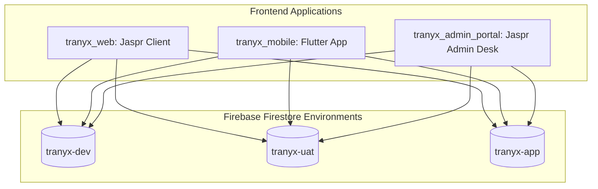

# Tranyx Admin Portal Testing & Invariants Ledger (`memory.md`)

This ledger documents the testing history, invariants, shared database architecture, and cross-project synchronization between the Admin Portal and the main application codebases (`tranyx_workspace`).

---

## 1. Architecture & Shared Database Overview

- **Shared Backends**: All three applications share the exact same Firestore backends (`tranyx-dev`, `tranyx-uat`, `tranyx-app`).
- **Single Source of Truth for Rules**: All Cloud Firestore security rules are maintained modularly in `/Users/zeuscajurao/Desktop/tranyx_workspace/firestore_rules/` and automatically compiled/mirrored into this project.
- **Predeploy Protection**: A Firebase CLI `predeploy` hook in `firebase.json` automatically runs `dart run tool/sync_rules.dart` before any deployment.

---

## 2. Ledger of Test Runs & Operational Milestones

| Date & Time | Test Category | Target File | Scope / Description | Results |
| :--- | :--- | :--- | :--- | :--- |
| 2026-09-20 21:30 | **Build & Deploy** | `lib/*`, `build/jaspr` | Admin Portal Jaspr web compilation, Tailwind CSS generation, and hosting release. | **PASSED** |
| 2026-09-26 12:20 | **Feature & Rules** | `lib/pages/sla_config.dart`, `platform_config` | Added Job SLA configuration editor and dedicated Dispute Arbitration Console in admin portal. | **PASSED** |
| 2026-09-29 05:53 | **Auth & Realtime** | `lib/core/providers/environment_provider.dart` | Real-time agent presence tracking, bootstrap credentials sync across dev/uat/prod. | **PASSED** |
| 2026-10-12 11:00 | **Security & Rules Sync** | `firestore.rules`, `tool/sync_rules.dart`, `firebase.json` | Cross-project rules synchronization established with `tranyx_workspace`. Replaced legacy monolithic rules with unified, hardened rules (48,335 bytes). CEL short-circuiting added to prevent 10-read exhaustion, zero privilege escalation on users, promo_audit_trail and qna subcollection added. | **PASSED** (0 diff with workspace, predeploy hook verified) |

---

## 3. Shared Database Collections & Permission Policies

| Collection | Role in Admin Portal | Access Rule / Constraint |
| :--- | :--- | :--- |
| `requests` | Unified P2P Request Desk | Authenticated read/create. Updates restricted to assigned agent within 3-minute deadline or admin override via `isAdminOrStaff()`. |
| `disputes` | Dispute Arbitration Console | Read by involved parties or `isAdminOrStaff()`. Resolutions strictly limited to `isAdminOrStaff()`. Nested `messages` and `notes` supported. |
| `promos` | Promo Management | Read by authenticated users; create/delete by `isAdminOrStaff()`. User updates restricted to `usedCount` and `usedBy`. |
| `promo_audit_trail` | Promo Audit Log | Read and write strictly guarded by `isAdminOrStaff()`. |
| `p2p_agents` | Verified P2P Agent Directory | Publicly readable QR credentials; updates restricted to admin/agent owner. |
| `presence` | Realtime Agent & Staff Presence | Public read for availability; write by agent owner or `isAdminOrStaff()`. |
| `system_config` | Treasury & Timeout Settings | Read and write strictly restricted to `isAdminOrStaff()` (including nested subcollections). |
| `platform_config` | Job SLAs & Platform Fees | Read by authenticated users; write restricted to `isAdminOrStaff()`. |
| `kyc_submissions` | User Identity Verification | Read by document owner or `isAdminOrStaff()`; write by active user owner or `isAdminOrStaff()`. |
| `audit_logs` / `admin_audit_logs` | System Activity & Audit Trail | Log viewing and management strictly restricted to `isAdminOrStaff()`. |

---

## 4. Protected Features & Invariants (Admin Portal Lockdown Ledger)

> [!IMPORTANT]
> **AGENT LOCKDOWN NOTICE — DO NOT MODIFY WITHOUT EXPLICIT USER PERMISSION**
>
> 1. **Cross-Project Firestore Rules Synchronization**:
>    - `firestore.rules` is auto-generated and synchronized from `tranyx_workspace/firestore_rules/`.
>    - NEVER author standalone rules inside this file or remove the `predeploy` hook from `firebase.json`.
>    - To deploy rules to Firebase, run `dart run tool/deploy_rules.dart [dev|uat|prod|all]`.
>
> 2. **P2P Agent 3-Minute Claim Window**:
>    - `lib/pages/requests.dart` and `requests/{requestId}` security rules.
>    - When a request is assigned to an agent, a strict 3-minute deadline (`claimDeadline`) is enforced. If the deadline expires without acceptance, the request re-opens to any active agent.
>
> 3. **Environment Authentication Synchronization**:
>    - `lib/core/providers/environment_provider.dart` (`syncEnvAuth`).
>    - Admin Portal users authenticate to `tranyx-admin-portal` and auto-sync credentials/bootstrap docs to the selected target environment (`tranyx-dev`, `tranyx-uat`, `tranyx-app`) so `isAdminOrStaff()` succeeds without 403 errors.
